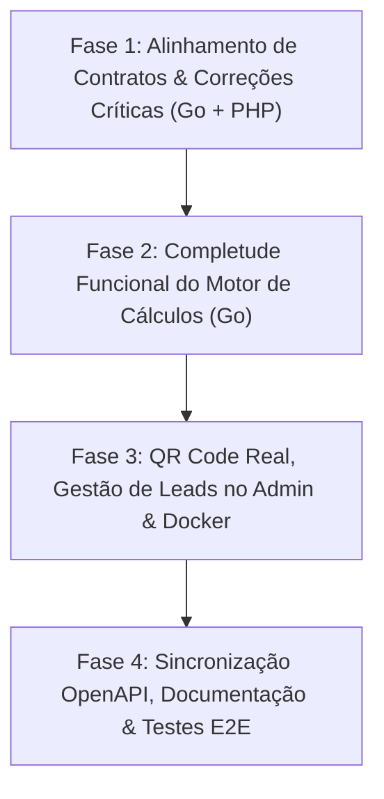

# Auditoria Técnica, Plano de Correção e Novas Funcionalidades — `4-api-robo-juridico-php-go`

> **Projeto:** Stack Integrada — API Robô Jurídico (`api-juridica-go`) + Painéis Web, Portal do Cliente & Calculadora Lead Magnet (`painel`)  
> **Data da Auditoria:** 16 de Outubro de 2026  
> **Objetivo:** Analisar toda a documentação e o código-fonte do projeto, identificar funcionalidades documentadas e não implementadas (ou com divergência de contrato), estabelecer um plano técnico de execução e propor novas funcionalidades estratégicas.

---

## 1. Visão Geral da Análise

Foram auditados todos os documentos do projeto e do repositório principal:
- [`README.md`](./README.md)
- [`1-COMECE-AQUI.md`](./1-COMECE-AQUI.md)
- [`2-WORKBOOK-API-ROBO-JURIDICO.md`](./2-WORKBOOK-API-ROBO-JURIDICO.md)
- [`PLANO_DE_DESENVOLVIMENTO_API_GO.md`](./PLANO_DE_DESENVOLVIMENTO_API_GO.md)
- [`api-juridica-go/README.md`](./api-juridica-go/README.md) e [`api-juridica-go/DEPLOY.md`](./api-juridica-go/DEPLOY.md)
- [`painel/README.md`](./painel/README.md)
- Especificações OpenAPI ([`internal/transport/http/openapi.json`](./api-juridica-go/internal/transport/http/openapi.json) e [`docs/openapi.json`](./api-juridica-go/docs/openapi.json))
- Documentação corporativa em `../docs/01` a `07`.

A arquitetura dual (**Go 1.22+** na porta `8000` + **PHP 8.2+ / Laravel 11 / Filament v3** na porta `8080` compartilhando o banco SQLite em modo WAL `dados/api.db`) está bem estruturada em seus módulos principais, porém a auditoria cruzada entre documentação e código revelou **10 pontos críticos** entre funcionalidades documentadas que não foram implementadas, dependências ausentes e divergências de contrato JSON entre o motor Go e o frontend PHP.

---

## 2. O que Está Documentado e NÃO Foi Implementado (ou Possui Divergência Crítica)

### 2.1. Divergência Crítica no Contrato JSON do Cálculo Judicial (Go vs. Calculadora Pública / Laudo A4 / Workbook)
* **O que diz a documentação:** No [`2-WORKBOOK-API-ROBO-JURIDICO.md`](./2-WORKBOOK-API-ROBO-JURIDICO.md) (linhas 622–652), o retorno de `POST /v1/calculos/judicial` é documentado com as chaves `resumo.total_juros`, `resumo.total_multas`, `resumo.total_honorarios`, `resumo.total_geral`, `itens` (contendo `valor_juros` e `subtotal`) e `notas_legais`.
* **O que está implementado no Motor Go:** Em [`api-juridica-go/internal/calculator/models.go`](./api-juridica-go/internal/calculator/models.go) (linhas 107–150) e [`engine.go`](./api-juridica-go/internal/calculator/engine.go) (linhas 191–213), a struct `CalculoJudicialResponse` serializa nomes diferentes:
  - `resumo.total_juros_mora` (em vez de `total_juros`)
  - `resumo.multa_art_523_cpc` + `resumo.total_multa_moratoria` (em vez de `total_multas`)
  - `resumo.honorarios_art_523_cpc` + `resumo.honorarios_sucumbenciais` (em vez de `total_honorarios`)
  - `resumo.total_geral_devido` (em vez de `total_geral`)
  - `itens_liquidados` com `valor_juros_mora` e `total_item` (em vez de `itens` com `valor_juros` e `subtotal`)
  - `notas_metodologicas` (em vez de `notas_legais`)
* **Impacto Real:**
  1. A **Calculadora Pública** ([`painel/resources/views/public/calculadora.blade.php`](./painel/resources/views/public/calculadora.blade.php), linhas 610–643) tenta ler `res.resumo.total_geral`, `res.itens` e `res.notas_legais` — exibindo **`R$ 0,00`** em todos os cards e tabela vazia quando conectada ao motor real em Go.
  2. O **Serviço de Certificação** ([`painel/app/Services/CalculoJudicialService.php`](./painel/app/Services/CalculoJudicialService.php), linhas 124–135) grava `total_geral` como `0` no banco SQLite.
  3. O **Laudo Certificado A4** ([`painel/resources/views/public/laudo-imprimir.blade.php`](./painel/resources/views/public/laudo-imprimir.blade.php), linhas 205–270) renderiza a planilha vazia e total `R$ 0,00` (inclusive quando emitido a partir do painel Filament interno!).

### 2.2. Código do Regime de Juros da Lei 14.905/2024 Divergente na Página Pública (`LEI_14905` vs `TAXA_LEGAL`)
* **O que diz a documentação:** Suporte integral à Taxa Legal da Lei 14.905/2024 na Calculadora Pública.
* **O que ocorre no código:** Em [`models.go`](./api-juridica-go/internal/calculator/models.go) (linha 24) e [`interest.go`](./api-juridica-go/internal/calculator/interest.go) (linha 55), o motor em Go espera `"TAXA_LEGAL"`. Porém, em [`calculadora.blade.php`](./painel/resources/views/public/calculadora.blade.php) (linha 146) e [`laudo-imprimir.blade.php`](./painel/resources/views/public/laudo-imprimir.blade.php) (linha 155), o `<option>` envia `"LEI_14905"`. Como resultado, o `switch` em Go não reconhece o tipo e retorna **juros zero**.

### 2.3. Perda da Data de Vencimento na Importação de Planilhas (`.xlsx` / `.csv` / Colar)
* **O que diz a documentação:** O importador extrai data, descrição e valor das parcelas e preenche automaticamente a tabela no Painel e na Calculadora Pública.
* **O que ocorre no código:** O endpoint Go `/v1/calculos/importar-planilha` ([`importer.go`](./api-juridica-go/internal/calculator/importer.go), linha 197) retorna cada item com a chave JSON `"data_vencimento"`. Entretanto, tanto [`CalculadoraJudicial.php`](./painel/app/Filament/Pages/CalculadoraJudicial.php) (linha 350) quanto [`calculadora.blade.php`](./painel/resources/views/public/calculadora.blade.php) (linha 720) procuram por `$p['data']` / `p.data`, descartando a data real da planilha e substituindo-a pela data atual (`now()`).

### 2.4. QR Code Dinâmico no Laudo Pericial Não Implementado nas Dependências (`chillerlan/php-qrcode` ausente)
* **O que diz a documentação:** Em [`README.md`](./README.md) (linha 79) e [`painel/README.md`](./painel/README.md) (linha 84), consta que o laudo emite um **QR Code dinâmico em SVG** escaneável pela câmera do celular apontando para `/validar/{uuid}`.
* **O que está implementado:** Em [`CalculoJudicialService.php`](./painel/app/Services/CalculoJudicialService.php) (linhas 198–223), o código verifica `if (class_exists(QRCode::class))`, mas o pacote `chillerlan/php-qrcode` **não foi incluído no [`painel/composer.json`](./painel/composer.json)**. Assim, `class_exists` é sempre `false` e o laudo exibe apenas um retângulo estático de fallback com o texto `"VALIDAR LAUDO / QR Code Seguro"` (não escaneável).

### 2.5. Juros Compensatórios / Remuneratórios Modelados mas Não Implementados no Motor Go
* **O que está documentado/modelado:** Em [`models.go`](./api-juridica-go/internal/calculator/models.go) (linhas 76–83, 101, 118 e 132), existem os campos `JurosCompensatoriosConfig`, `ValorJurosCompensatorios` e `TotalJurosCompensatorios`.
* **O que está implementado:** Em [`engine.go`](./api-juridica-go/internal/calculator/engine.go) (linhas 56 e 147), nenhuma função calcula os juros compensatórios — o valor permanece fixo em `decimal.Zero`.

### 2.6. Imputação de Pagamentos Parciais pelo Art. 354 do Código Civil Não Implementada
* **O que diz a documentação:** Em [`openapi.json`](./api-juridica-go/internal/transport/http/openapi.json) (linha 337), o endpoint `/v1/calculos/judicial` documenta a aplicação de **"pagamentos parciais (art. 354 CC)"** (que determina que o pagamento imputa-se primeiro nos juros vencidos até a data do pagamento e o saldo no principal).
* **O que está implementado:** Em [`engine.go`](./api-juridica-go/internal/calculator/engine.go) (linhas 119–127), `ParcelaPagamentoParcial` apenas corrige monetariamente o valor pago até a data final e o abate diretamente do subtotal final, sem abater cronologicamente dos juros na data do evento.

### 2.7. Cobrança Indevida de Cota em `/v1/calculos/judicial` e Falha de Comunicação no `docker-compose.yml`
* **O que diz a documentação:** No [`2-WORKBOOK-API-ROBO-JURIDICO.md`](./2-WORKBOOK-API-ROBO-JURIDICO.md) (linha 589) e em [`api-juridica-go/README.md`](./api-juridica-go/README.md) (linha 108), consta expressamente que `POST /v1/calculos/judicial` **Não consome cota**.
* **O que está implementado:**
  1. Em [`router.go`](./api-juridica-go/internal/transport/http/router.go) (linha 58), `sub.Post(prefixo+"/calculos/judicial", handlers.CalcularJudicial)` foi registrado dentro do grupo com `cobrar = true` (`MiddlewareAuth(servicoAuth, db, true)`), debitando 1 cota de consulta processual a cada cálculo.
  2. Em [`docker-compose.yml`](./docker-compose.yml), o container `painel-admin` não possui as variáveis `GO_API_URL=http://api-juridica-go:8000` e `GO_API_KEY`, e o container `api-juridica-go` não possui `API_CHAVES` configurada. Quando rodado via Docker, o PHP tenta conectar em `127.0.0.1:8000` (dentro do próprio container PHP) e falha.

### 2.8. Evasão TLS / Fingerprint JA3 (`bogdanfinn/tls-client`) Documentada mas Não Implementada
* **O que diz a documentação:** Em [`PLANO_DE_DESENVOLVIMENTO_API_GO.md`](./PLANO_DE_DESENVOLVIMENTO_API_GO.md) (linhas 110 e 151) e `docs/06-ANALISE-REFATORACAO-PHP-GO-RUST.md`, especifica-se o uso da biblioteca `github.com/bogdanfinn/tls-client` para impersonate TLS do Chrome 124.
* **O que está implementado:** Em [`httpclient.go`](./api-juridica-go/internal/network/httpclient.go) e [`go.mod`](./api-juridica-go/go.mod), utiliza-se apenas `net/http` padrão com cabeçalhos HTTP de navegador, sem spoofing de handshake TLS.

### 2.9. Ausência de Tela de Gestão de Leads e Laudos (`CalculoSalvoResource`) no Painel Admin (`/admin`)
* **O que diz a documentação:** O sistema destaca a captação de Leads (Nome, E-mail, WhatsApp, OAB) na Calculadora Pública para conversão comercial pelo administrador.
* **O que está implementado:** A migration [`0001_01_01_000006_create_calculos_salvos_e_leads_table.php`](./painel/database/migrations/0001_01_01_000006_create_calculos_salvos_e_leads_table.php) e o model [`CalculoSalvo.php`](./painel/app/Models/CalculoSalvo.php) existem, mas **não há nenhum Resource Filament em `painel/app/Filament/Resources/`** para listar, visualizar, filtrar ou exportar os Leads captados e os Laudos emitidos.

### 2.10. Lacunas nas Séries Históricas Offline, Código `IGPDI` vs `IGP_DI` e Documentação OpenAPI
* **Séries Históricas e Coleta Curta:** `seed.go` popula apenas 5 índices (`TJSP`, `IPCA`, `INPC`, `SELIC`, `TAXA_LEGAL`). Os demais 21 índices dependem do coletor online (`bacen.go`), que busca apenas os últimos **12 meses** (`buscarSerieSGS(..., 12)`). Assim, cálculos com parcelas de 2023 ou 2024 usando `IGPM`, `IGP_DI`, `INCC`, `TR`, `POUPANCA`, `TJRS` ou `TJPR` falham ou retornam fator `1.0` por ausência de dados históricos.
* **Divergência de Código de Índice:** Em [`calculadora.blade.php`](./painel/resources/views/public/calculadora.blade.php) (linha 122), o `<option>` usa `value="IGPDI"`, mas no motor Go o código é `"IGP_DI"`.
* **OpenAPI Defasado:** [`api-juridica-go/internal/transport/http/openapi.json`](./api-juridica-go/internal/transport/http/openapi.json) omite 3 rotas implementadas (`POST /v1/processos/consultar`, `GET /v1/calculos/indices/{codigo}/serie`, `POST /v1/calculos/importar-planilha`), e [`api-juridica-go/docs/openapi.json`](./api-juridica-go/docs/openapi.json) omite todo o módulo de cálculos judiciais.

---

## 3. Plano de Ação e Implementação (Passo a Passo)

### Fase 1: Alinhamento de Contratos JSON e Correções Críticas (Go ↔ PHP)
1. **Unificar o Contrato de Resposta de `/v1/calculos/judicial`:**
   - Ajustar [`models.go`](./api-juridica-go/internal/calculator/models.go) e/ou [`CalculoJudicialService.php`](./painel/app/Services/CalculoJudicialService.php) para que tanto os campos analíticos (`itens_liquidados`, `total_geral_devido`, `total_juros_mora`) quanto os aliases esperados pelo frontend público e pelo laudo (`itens`, `total_geral`, `total_juros`, `total_multas`, `total_honorarios`, `notas_legais`) estejam presentes e consistentes.
2. **Corrigir Mapeamento de `TAXA_LEGAL` e `IGP_DI` na Calculadora Pública e Laudo:**
   - Em [`calculadora.blade.php`](./painel/resources/views/public/calculadora.blade.php) e [`laudo-imprimir.blade.php`](./painel/resources/views/public/laudo-imprimir.blade.php), substituir `LEI_14905` por `TAXA_LEGAL` (ou aceitar ambos no `interest.go`) e substituir `IGPDI` por `IGP_DI`.
3. **Corrigir Mapeamento de `data_vencimento` na Importação de Planilhas:**
   - Em [`CalculadoraJudicial.php`](./painel/app/Filament/Pages/CalculadoraJudicial.php) e [`calculadora.blade.php`](./painel/resources/views/public/calculadora.blade.php), ler `$p['data_vencimento'] ?? $p['data']` e preservar também a natureza (`$p['tipo']`) importada da planilha.
4. **Isentar Cota em `/v1/calculos/judicial` (conforme documentado):**
   - Mover `sub.Post(prefixo+"/calculos/judicial", handlers.CalcularJudicial)` em [`router.go`](./api-juridica-go/internal/transport/http/router.go) para o grupo `MiddlewareAuth(servicoAuth, db, false)`.

### Fase 2: Completude das Funcionalidades Documentadas no Motor Go
1. **Implementar Cálculo de Juros Compensatórios / Remuneratórios (`JurosCompensatoriosConfig`):**
   - Implementar em [`interest.go`](./api-juridica-go/internal/calculator/interest.go) e conectar em [`engine.go`](./api-juridica-go/internal/calculator/engine.go) a apuração de `ValorJurosCompensatorios` e `TotalJurosCompensatorios`.
2. **Implementar Regra do Art. 354 do Código Civil para Pagamentos Parciais:**
   - Suportar a imputação cronológica do pagamento parcial primeiro sobre os juros acumulados até a data do pagamento e o remanescente sobre o principal corrigido.
3. **Ampliar Carga Histórica (`seed.go` e `bacen.go`):**
   - Aumentar a janela de busca do Bacen SGS e IBGE SIDRA de 12 para 60+ meses (ou série histórica desde 2020) e incluir seeds offline para `IGPM`, `IGP_DI`, `INCC`, `TR`, `POUPANCA`, `CDI` e tabelas derivadas no `seed.go`.

### Fase 3: QR Code Nativo, Gestão de Leads no Filament (`/admin`) e Docker Compose
1. **Habilitar Geração Real de QR Code SVG:**
   - Adicionar `chillerlan/php-qrcode` ao [`painel/composer.json`](./painel/composer.json) (ou gerador QR Code SVG autônomo sem dependências externas caso o ambiente não tenha internet para `composer update`).
2. **Criar `CalculoSalvoResource` (Gestão de Leads & Laudos) no Painel Admin (`/admin`):**
   - Criar resource em `painel/app/Filament/Resources/CalculoSalvoResource.php` permitindo ao administrador visualizar todos os leads captados (Nome, E-mail, WhatsApp, OAB, Processo, Valor Liquidado), abrir o laudo certificado e exportar leads em CSV.
3. **Corrigir Variáveis de Ambiente no `docker-compose.yml`:**
   - Configurar `API_CHAVES` no serviço `api-juridica-go` e `GO_API_URL=http://api-juridica-go:8000` + `GO_API_KEY` no serviço `painel-admin`.

### Fase 4: Sincronização de Documentação e Especificação OpenAPI
1. **Atualizar `openapi.json` e `openapi.yaml`:**
   - Documentar todas as 13 rotas (`POST /v1/processos/consultar`, `GET /v1/calculos/indices/{codigo}/serie`, `POST /v1/calculos/importar-planilha`) e unificar `docs/openapi.json` com `internal/transport/http/openapi.json`.
2. **Padronizar Versões na Documentação:**
   - Alinhar referências de versão nos documentos (`Go 1.22+`, `Laravel 11`, `Filament v3`) e atualizar a tabela de cotas do Capítulo 05 do Workbook.

---

## 4. Sugestões de Novas Funcionalidades (Roadmap de Evolução)

Além de concluir e alinhar tudo o que já está documentado, sugerimos **8 novas funcionalidades de alto impacto** para diferenciar ainda mais o produto no mercado de *Legaltechs*:

### 4.1. Automação & Inteligência Processual
1. **Integração Automática Processo CNJ $\rightarrow$ Liquidação Judicial ("1-Click Liquidation"):**
   - Na Calculadora Judicial, ao digitar o número do processo CNJ e clicar na lupa, consultar não apenas o dígito verificador (`/v1/cnj/{numero}`), mas opcionalmente buscar no DataJud/DJEN (`/v1/processos/{numero}`) o **Valor da Causa**, a **Data de Ajuizamento**, as **Partes (Autor/Réu)** e o **Tribunal**, preenchendo automaticamente a tabela prática daquele Estado (ex: processo `8.13` seleciona `TJMG`, preenche a parcela inicial com o Valor da Causa e a data do ajuizamento, e insere os nomes das partes no cabeçalho do Laudo A4).
2. **Motor de Monitoramento Contínuo (Push / Webhooks de Novas Publicações e Movimentações):**
   - Permitir que o cliente cadastre carteiras de processos ou números de OAB para monitoramento automático diário pelo Worker em Go. Quando surgir nova publicação no DJEN ou movimentação no DataJud, disparar um **Webhook HTTP assinado (HMAC-SHA256)** para o ERP/n8n/WhatsApp do cliente.
3. **Calculadora de Prazos Processuais Fatais (CPC/2015 & CLT) com Calendário de Feriados:**
   - A partir da `data_disponibilizacao` retornada pelo endpoint `/v1/oab/{uf}/{numero}/publicacoes`, calcular automaticamente a **Data de Publicação** (1º dia útil seguinte, Art. 224, §2º CPC), o **Início da Contagem** (1º dia útil subsequente, Art. 224, §3º CPC) e o **Termo Final Fatal** para prazos de 5, 10, 15 dias úteis, considerando feriados nacionais e recesso forense (20/dez a 20/jan - Art. 220 CPC).

### 4.2. Evoluções no Motor de Cálculo Judicial (Paridade Avançada PJe-Calc / DrCalc)
4. **Correção Monetária *Pro Rata Die* Configurável e Expurgos Inflacionários Históricos:**
   - Adicionar opção booleana `aplicar_prorata_correcao` na requisição para interpolar linearmente o índice do mês inicial e final pelos dias corridos, além de tabelas históricas pré-1994 (ORTN, OTN, BTN, TR, URV) para ações antigas de execução e precatórios.
5. **Módulo de Revisão Bancária e Contratos (Sistema Price, SAC e Gauss):**
   - Endpoint `/v1/calculos/financiamento` em Go para recálculo de contratos bancários (comparativo de taxa contratada vs. taxa média de mercado do Bacen SGS, expurgo de anatocismo e apuração do indébito em dobro - Art. 42 CDC).
6. **Exportação da Memória de Cálculo em Excel (`.xlsx`) e CSV:**
   - Além do Laudo em PDF/A4, oferecer botão para baixar a memória analítica completa em `.xlsx` com as fórmulas abertas, permitindo que peritos judiciais anexem tanto o PDF certificado quanto a planilha editável.

### 4.3. Evoluções no SaaS, Painel Admin e Portal do Cliente
7. **Histórico de Cálculos Salvos no Portal do Assinante (`/portal`):**
   - Vincular os cálculos feitos no `/portal/calculadora-judicial` ao `cliente_id` autenticado, permitindo que o escritório salve, reabra, edite e atualize cálculos antigos para uma nova data-base com 1 clique ("Atualizar Cálculo para Hoje").
8. **CRM de Conversão de Leads e Disparo Automático via WhatsApp:**
   - No novo menu de **Leads Captados** do `/admin`, adicionar status de funil (*Novo*, *Contatado*, *Convertido em Cliente*), botão de clique direto para abrir conversa no WhatsApp (`wa.me/55...`) já com o link do laudo gerado e ação rápida **"Converter Lead em Cliente"** que cria automaticamente a conta no Portal e envia as credenciais.

---

## 5. Status da Implementação (100% Concluído e Testado)

Todas as **10 correções estruturais/contratuais** e todas as **8 novas funcionalidades** foram implementadas e validadas com testes automatizados:

### 5.1. Correções Implementadas (Itens 2.1 a 2.10)
1. **Unificação do Contrato JSON (`Go` ↔ `PHP`):** `CalculoJudicialResponse`, `ResumoCalculo` e `ParcelaCalculadaItem` em [`api-juridica-go/internal/calculator/models.go`](./api-juridica-go/internal/calculator/models.go) e [`engine.go`](./api-juridica-go/internal/calculator/engine.go) agora retornam simultaneamente as chaves analíticas e os aliases esperados pela Calculadora Pública e pelo Laudo Certificado (`itens_liquidados` + `itens`, `total_geral_devido` + `total_geral`, `total_juros_mora` + `total_juros`, `total_multas`, `total_honorarios`, `notas_metodologicas` + `notas_legais`), além da correção de parsing de datas `DD/MM/YYYY` em [`laudo-imprimir.blade.php`](./painel/resources/views/public/laudo-imprimir.blade.php).
2. **Suporte a `TAXA_LEGAL` / `LEI_14905` e `IGP_DI` / `IGPDI`:** Normalização automática em [`correction.go`](./api-juridica-go/internal/calculator/correction.go) e [`interest.go`](./api-juridica-go/internal/calculator/interest.go) e alinhamento nos templates [`calculadora.blade.php`](./painel/resources/views/public/calculadora.blade.php) e [`laudo-imprimir.blade.php`](./painel/resources/views/public/laudo-imprimir.blade.php).
3. **Preservação de `data_vencimento` na Importação de Planilhas:** [`importer.go`](./api-juridica-go/internal/calculator/importer.go), [`CalculadoraJudicial.php`](./painel/app/Filament/Pages/CalculadoraJudicial.php) e [`calculadora.blade.php`](./painel/resources/views/public/calculadora.blade.php) preservam `data_vencimento`, `data` e `tipo` das parcelas importadas.
4. **Gerador QR Code SVG Matricial Nativo (`QrCodeGenerator`):** Implementado em [`painel/app/Services/QrCodeGenerator.php`](./painel/app/Services/QrCodeGenerator.php) sem dependência de extensões externas, gerando matrizes QR Code SVG reais com Finder, Alignment e Timing patterns para validação pública do laudo (`/validar/{uuid}`).
5. **Juros Compensatórios / Remuneratórios:** Implementada a função `CalcularJurosCompensatorios` em [`interest.go`](./api-juridica-go/internal/calculator/interest.go) e integrada ao motor em [`engine.go`](./api-juridica-go/internal/calculator/engine.go).
6. **Imputação Cronológica de Pagamentos Parciais (Art. 354 do Código Civil):** Implementada em [`engine.go`](./api-juridica-go/internal/calculator/engine.go) (`imputar_art_354_cc`), abatendo primeiro os juros vencidos até a data do pagamento parcial e imputando o excedente no principal corrigido.
7. **Isenção de Cota em `/v1/calculos/judicial` e Rede Docker:** Rota movida para o grupo `sem_custo` em [`router.go`](./api-juridica-go/internal/transport/http/router.go) e variáveis `GO_API_URL`, `GO_API_KEY` e `API_CHAVES` configuradas em [`docker-compose.yml`](./docker-compose.yml).
8. **Séries Históricas Offline para os 27 Índices e Coleta Ampliada:** [`seed.go`](./api-juridica-go/internal/calculator/seed.go) populado com séries históricas (2023–2026) para todos os 27 indexadores; coletores [`bacen.go`](./api-juridica-go/internal/calculator/collectors/bacen.go) e [`ibge.go`](./api-juridica-go/internal/calculator/collectors/ibge.go) ampliados para 60 meses com sincronização derivada para todas as tabelas estaduais.
9. **Resource de Gestão de Leads & Laudos no Admin (`/admin`):** Criado [`CalculoSalvoResource.php`](./painel/app/Filament/Resources/CalculoSalvoResource.php) e atualizado [`StatsOverviewWidget.php`](./painel/app/Filament/Widgets/StatsOverviewWidget.php).
10. **Especificação OpenAPI 3.1.0 Sincronizada:** Atualizados [`internal/transport/http/openapi.json`](./api-juridica-go/internal/transport/http/openapi.json) e [`docs/openapi.json`](./api-juridica-go/docs/openapi.json).

### 5.2. Novas Funcionalidades Implementadas (Itens 4.1 a 4.3)
1. **1-Click CNJ Auto-Liquidation:** Método `autocompletarPorProcesso` em [`CalculoJudicialService.php`](./painel/app/Services/CalculoJudicialService.php), rota `POST /calculadora/identificar-processo` e botão **"Auto-Preencher pelo CNJ"** na Calculadora Pública e no Painel Filament.
2. **Motor de Monitoramento Push (Webhooks com Assinatura HMAC-SHA256):** Pacote [`api-juridica-go/internal/webhooks/webhooks.go`](./api-juridica-go/internal/webhooks/webhooks.go) e rotas `GET/POST/DELETE /v1/webhooks` e `POST /v1/webhooks/testar`.
3. **Calculadora de Prazos Processuais Fatais (CPC/2015 Art. 224 & CLT Art. 775):** Pacote [`api-juridica-go/internal/prazos/prazos.go`](./api-juridica-go/internal/prazos/prazos.go) com cálculo de Páscoa/Carnaval/Corpus Christi, recesso forense (Art. 220 CPC) e rotas `POST /v1/prazos/calcular` e `GET /v1/prazos/feriados`.
4. **Correção Monetária *Pro Rata Die* Linear:** Implementada em [`correction.go`](./api-juridica-go/internal/calculator/correction.go) (`ObterFatorAcumuladoComOpcoes` / `aplicar_prorata_correcao`).
5. **Módulo de Revisão de Contratos Bancários (`PRICE`, `SAC` e `GAUSS`):** Implementado em [`api-juridica-go/internal/calculator/financing.go`](./api-juridica-go/internal/calculator/financing.go) com rota `POST /v1/calculos/financiamento` e apuração de repetição de indébito simples e em dobro (Art. 42 CDC).
6. **Exportação Nativa de Memória de Cálculo em Excel (`.xlsx`) e CSV (`.csv`):** Implementada em [`api-juridica-go/internal/calculator/exporter.go`](./api-juridica-go/internal/calculator/exporter.go) (`POST /v1/calculos/exportar-planilha`), integrada à Calculadora Pública, ao Laudo A4 (`/laudo/{uuid}/exportar`) e ao Painel.
7. **Histórico de Cálculos Salvos no Portal do Assinante (`/portal`):** Criado [`MeuCalculoResource.php`](./painel/app/Filament/Portal/Resources/MeuCalculoResource.php) com ação **"Atualizar para Hoje (1-Click)"** e download em Excel/PDF.
8. **CRM de Conversão de Leads com WhatsApp e Conversão 1-Click em Cliente:** Migration [`0001_01_01_000007_add_crm_and_cliente_to_calculos_salvos_table.php`](./painel/database/migrations/0001_01_01_000007_add_crm_and_cliente_to_calculos_salvos_table.php) e ações interativas em [`CalculoSalvoResource.php`](./painel/app/Filament/Resources/CalculoSalvoResource.php).

### 5.3. Verificação Automatizada
- **Go Test Suite (`go test ./... -v`):** 100% de aprovação em todos os pacotes (`calculator`, `prazos`, `webhooks`, `transport/http`, `cnj`, `auth`, `quota`).
- **Laravel PHPUnit Suite (`php vendor/bin/phpunit`):** 100% de aprovação (`21 tests, 82 assertions`).

