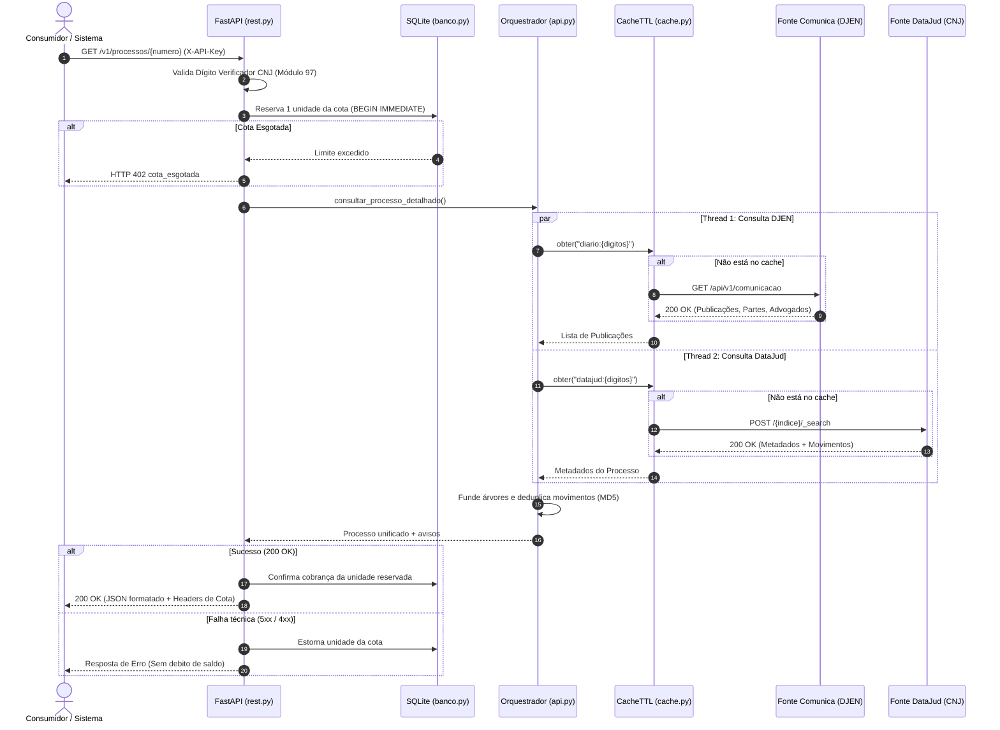
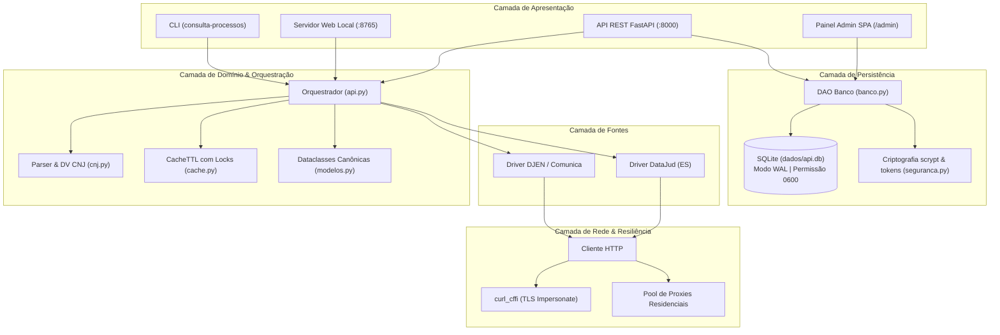
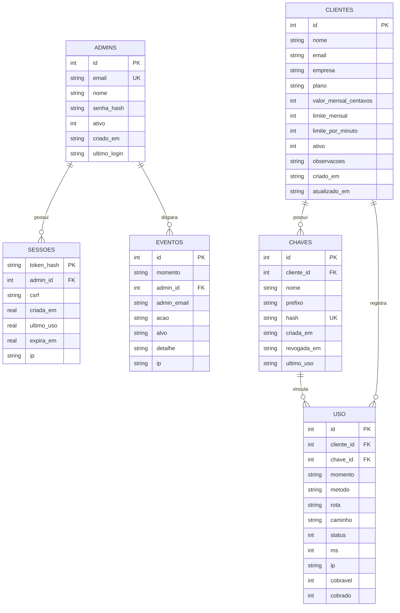

# Especificação Técnica e Arquitetura de Software: Robô Jurídico

> **Identificador:** DOC-TEC-RJ-001  
> **Versão:** 1.0.0  
> **Linguagem & Frameworks:** Python 3.10+, FastAPI, SQLite WAL, HTTPX / Curl-CFFI  
> **Status:** Ativo / Baseline  
> **Data:** Outubro de 2026  

---

## 1. Visão Geral da Arquitetura

O **Robô Jurídico (`consulta-processos`)** é arquitetado em um padrão modular em camadas com separação estrita de responsabilidades:
1. **Camada de Apresentação & Interfaces:** CLI (`cli.py`), Web UI Local (`web.py`) e REST API (`rest.py` + `painel/rotas.py`).
2. **Camada de Negócio & Orquestração:** Core Engine (`api.py`), Validador e Roteador CNJ (`cnj.py`), Modelos Canônicos (`modelos.py`) e Cache TTL Concorrente (`cache.py`).
3. **Camada de Integração com Fontes Oficiais:** Drivers dedicados para DataJud (`fontes/datajud.py`) e Diário DJEN (`fontes/comunica.py`).
4. **Camada de Transporte e Rede:** Evasão TLS, impersonate de navegadores e gestão de proxies residenciais concorrentes (`http.py` e `proxies.py`).
5. **Camada de Persistência & Governança:** SQLite com WAL, gestão atômica de cotas, trilha de auditoria e segurança criptográfica (`painel/banco.py` e `painel/seguranca.py`).

---

## 2. Diagramas Arquiteturais

### 2.1. Diagrama de Fluxo de Execução da Consulta Unificada

### 2.2. Diagrama de Blocos e Camadas do Sistema

---

## 3. Detalhamento dos Componentes Internos

### 3.1. Validador e Roteador CNJ (`consulta_processos/cnj.py`)
- **Padrão Normativo:** Resolução CNJ nº 65/2008.
- **Formato:** `NNNNNNN-DD.AAAA.J.TR.OOOO`.
- **Validação de Dígito Verificador (Módulo 97):**
  A validação ocorre antes de qualquer tráfego de rede ou debito de cota. A fórmula implementada em `rest.py`:
  $$\text{Base} = \text{NNNNNNN} \mathbin{\Vert} \text{AAAA.J.TR.OOOO} \mathbin{\Vert} \text{"00"}$$
  $$\text{DV Calculado} = 98 - (\text{Base} \pmod{97})$$
  Se $\text{DV Calculado} \neq \text{DD}$, a requisição é imediatamente rejeitada com status HTTP 422.
- **Roteamento Dinâmico de Índices:**
  O campo `J` (Segmento) e `TR` (Tribunal) identificam diretamente a corte judiciária:
  - $J=8$ (Justiça Estadual): Mapeia para `TJAC` até `TJTO`.
  - $J=4$ (Justiça Federal): Mapeia para `TRF1` até `TRF6`.
  - $J=5$ (Justiça do Trabalho): Mapeia para `TRT1` até `TRT24` ou `TST` ($TR=0$).
  - Tribunais Superiores: `STF`, `STJ`, `STM`, `TSE`.
  - Índice Elasticsearch correspondente: `api_publica_{sigla.lower()}` (ex.: `api_publica_tjsp`).

### 3.2. Deduplicação e Fusão de Movimentações (`consulta_processos/api.py`)
Ao combinar as movimentações internas do DataJud com as publicações do DJEN:
1. **Normalização de Fuso Horário:** Ambas as fontes são forçadas para datas com fuso horário UTC (`timezone.utc`), evitando exceções em comparações cronológicas.
2. **Geração de ID Externo Resiliente:** Atos simultâneos no mesmo segundo recebem uma assinatura MD5 baseada nos primeiros 100 caracteres da descrição:
   $$\text{ID} = \text{codigo} \mathbin{\Vert} \text{"\_"} \mathbin{\Vert} \text{dataHora}_{0..19} \mathbin{\Vert} \text{"\_"} \mathbin{\Vert} \text{MD5}(\text{descricao})_{0..8}$$
   Caso ocorram dois atos idênticos no mesmo segundo, um sufixo sequencial é anexado (`_2`, `_3`), impedindo colisões de chave primária no banco do consumidor.
3. **Enriquecimento de Metadados:** Se o DataJud trouxer a capa vazia de advogados/partes, as partes e advogados listados nos destinatários das publicações do DJEN são incorporados ao processo principal.

### 3.3. Cache TTL Concorrente e Anti-Thundering Herd (`consulta_processos/cache.py`)
- **Estrutura:** `CacheTTL` baseada em `OrderedDict` com capacidade máxima (LRU: 500 itens).
- **Single-Flight Lock:** Cada chave de consulta possui um `threading.Lock` dedicado (`_travas[chave]`).
- **Comportamento sob Concorrência:**
  Se duas ou mais threads solicitarem o mesmo processo não cacheado ao mesmo tempo, a primeira obtém a trava e executa a chamada HTTP lenta ao CNJ. As demais ficam suspensas na trava. Quando a primeira conclui e grava no cache, as threads subsequentes são liberadas, encontram o dado já em memória e retornam imediatamente sem disparar novas chamadas externas.
- **Isolamento de Falhas:** Erros ou exceções disparados pela chamada **não são gravados no cache**, permitindo que a próxima consulta tente novamente de forma limpa.

### 3.4. Camada de Rede, Evasão e Proxies (`consulta_processos/http.py` e `proxies.py`)
- **Impersonate TLS:** Integração com a biblioteca `curl_cffi` para replicar o handshake TLS (JA3/JA4 fingerprinting) de navegadores modernos (`chrome124`, `edge101`, `safari17_2_ios`).
- **Resolução de Bloqueio Geográfico do DJEN:** O WAF do portal gov.br descarta conexões com IP de origem internacional (HTTP 403). O módulo de proxies permite:
  - Definir lista fixa de proxies via `CONSULTA_PROXIES`.
  - Expandir um gateway residencial em $N$ portas (`CONSULTA_GATEWAY_HOST` + `PORTA_INICIAL` + `PORTAS`), onde cada porta conecta a uma saída residencial brasileira distinta.
  - Provedores com API de catálogo (ex.: Proxy-Seller).
- **Competição Paralela de Proxies (Racing Requests):**
  Como proxies residenciais sofrem frequentemente com latência elevada ou nós inoperantes, o método `get()` divide os proxies em lotes (`CONSULTA_PROXIES_PARALELO = 4`) e despacha requisições concorrentes em um `ThreadPoolExecutor`. Assim que o primeiro nó retorna uma resposta definitiva (HTTP 200, 400 ou 404), o executor é abortado (`shutdown(wait=False)`) e a resposta vencedora é entregue instantaneamente.

---

## 4. Arquitetura do Banco de Dados SQLite (`dados/api.db`)

O banco de dados relacional utiliza o motor SQLite nativo, configurado com `PRAGMA journal_mode=WAL` (Write-Ahead Logging), permitindo leituras concorrentes ilimitadas enquanto transações de escrita são executadas de forma isolada com `BEGIN IMMEDIATE`.

### 4.1. Diagrama Entidade-Relacionamento (ERD)

### 4.2. Mecanismo de Controle Atômico de Cotas
Para garantir que chamadas simultâneas não ultrapassem o limite contratado pelo cliente:
1. Ao receber a requisição, o método `banco.reservar(...)` inicia uma transação com `BEGIN IMMEDIATE`.
2. Conta o número de registros em `uso` com `cobrado = 1` no mês corrente (`momento >= inicio_do_mes`).
3. Se `usado >= limite_mensal`, insere um registro com status 402, aborta e retorna permissão negada.
4. Se o limite não foi atingido, insere um registro preliminar com `cobrado = 1` e commit na transação.
5. No fechamento da requisição HTTP (middleware Starlette):
   - Se o status final for menor que 400 (sucesso), mantém `cobrado = 1`.
   - Se o status final for $\ge 400$ (falha na fonte do CNJ, número não encontrado, etc.), executa `UPDATE uso SET cobrado = 0`, **estornando o saldo do cliente**.

---

## 5. Especificação de Segurança e Criptografia

| Elemento de Segurança | Tecnologia / Implementação | Detalhes Técnicos |
|---|---|---|
| **Hash de Senhas (Admin)** | `scrypt` | $N=16384, r=8, p=1$, Salt criptográfico aleatório de 16 bytes. Comparação em tempo constante via `hmac.compare_digest`. |
| **Armazenamento de API Keys** | `SHA-256` | Apenas o hash hexadecimal é gravado no banco. O cliente recebe a chave crua uma única vez no momento da criação. |
| **Proteção de Sessão Web** | Cookie Seguro | Nome: `rj_sessao`. Flags: `HttpOnly`, `SameSite=Strict`, `Secure` (quando HTTPS ativado). Validade ociosa: 30 minutos; validade absoluta: 12 horas. |
| **Proteção Anti-CSRF** | Token CSRF por Sessão | Token de 32 bytes gerado via `secrets.token_urlsafe()`. Validado via cabeçalho `X-CSRF-Token` em todas as rotas com mutação de dados. |
| **Proteção contra Força Bruta** | Sliding Window em Memória | 10 tentativas com chave incorreta por minuto bloqueiam temporariamente o IP com código HTTP 429 e header `Retry-After`. |
| **Isolamento de Acesso** | Whitelist CIDR | Restringe o acesso às rotas do painel `/admin` por faixas de IP (`PAINEL_IPS_PERMITIDOS`). IPs não autorizados recebem HTTP 404 neutro. |
