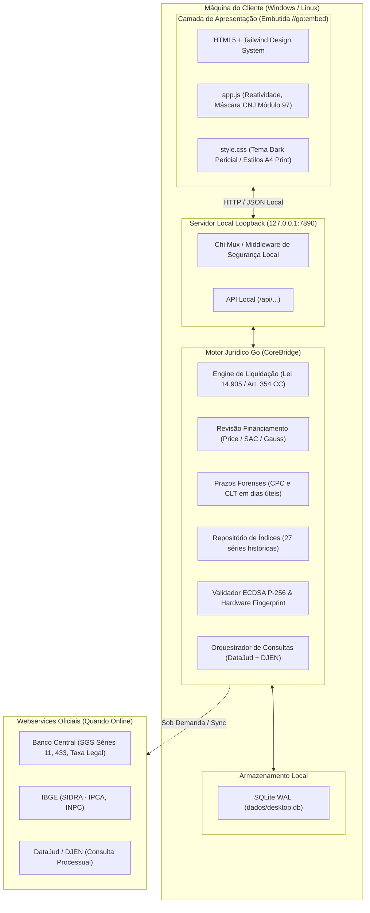

# 08 · Guia de Arquitetura e Operação: Sistema Jurídico Desktop On-Premise

> **Documento de Engenharia & Manual Operacional:** Especificação completa da versão desktop do Robô Jurídico (`5-app-juridico-desktop`), projetada para rodar 100% dentro da máquina do cliente (Windows e Linux) com motor Go nativo, SQLite WAL, zero dependências externas e licenciamento criptográfico por hardware.

---

## 1. Visão Geral e Motivação

Enquanto as versões web e API SaaS (`3-api-robo-juridico` e `4-api-robo-juridico-php-go`) atendem a servidores em nuvem e provedores de serviços, a versão **Desktop On-Premise (`5-app-juridico-desktop`)** foi desenvolvida para atender às demandas de:

1. **Privacidade Absoluta e LGPD:** Advogados e peritos judiciais que não podem enviar dados de processos confidenciais ou valores de clientes para servidores de terceiros.
2. **Operação Offline:** Realização de cálculos de liquidação de sentença, contagem de prazos e revisão bancária em locais sem conexão com a internet (audiências, fóruns, viagens).
3. **Distribuição Simplificada (Zero-Config):** Um executável único de ~18 MB que não exige instalação de Docker, PHP, Python, Node.js ou bancos de dados externos.

---

## 2. Diagrama da Arquitetura Desktop



---

## 3. Módulo de Licenciamento e Proteção de Propriedade Intelectual

Para viabilizar a monetização segura sem necessidade de conexão contínua com a internet:

### 3.1. Hardware Fingerprint (Identificador Único da Máquina)
O sistema coleta o identificador de hardware do computador:
* **No Windows:** Consulta o UUID da placa-mãe via WMI (`Win32_ComputerSystemProduct.UUID`) ou chave de registro `MachineGuid`.
* **No Linux:** Lê `/sys/class/dmi/id/product_uuid` ou `/etc/machine-id`.
* **Fallback Resiliente:** Hash SHA-256 das interfaces de rede físicas (MAC addresses) + Hostname.
* **Formato Gerado:** `JUR-XXXX-XXXX-XXXX-XXXX` (ex: `JUR-5B40-151F-FFE8-63CB`).

### 3.2. Assinatura Criptográfica ECDSA (Curva NIST P-256)
* O desenvolvedor/empresa detém a **Chave Privada** em seu servidor seguro.
* O executável desktop contém a **Chave Pública** embutida.
* A licença emitida contém o JSON assinado com validade, plano, hardware ID e recursos liberados. Se o cliente tentar adulterar qualquer campo, a assinatura torna-se matematicamente inválida e o sistema bloqueia o uso.

---

## 4. Funcionalidades Periciais e Jurídicas

### 4.1. Liquidação Judicial de Sentença
* **Paridade PJe-Calc e DrCalc:** Precisão com `shopspring/decimal` (ponto fixo sem erros de arredondamento de float).
* **Lei 14.905/2024:** Aplicação da nova taxa legal de juros moratórios do Código Civil (SELIC deduzida do IPCA) com piso zero.
* **Imputação do Art. 354 do Código Civil:** Abatimento de pagamentos parciais priorizando primeiro os juros vencidos e, em seguida, o principal corrigido.
* **Encargos da Execução:** Multa de 10% e honorários de 10% do Art. 523 do CPC/2015.
* **Exportação:** Emissão de memória analítica mês a mês pronta para exportar em `.csv` (Excel) e impressão em formato Laudo Pericial A4.

### 4.2. Consulta Unificada CNJ (DataJud + DJEN) & Visualizador de Documentos Oficiais
* **Validação Módulo 97 e Limpeza Automática:** Validação em tempo real do dígito verificador CNJ enquanto o advogado digita, limpando imediatamente qualquer resultado anterior ao alterar o número do processo.
* **Card Animado de Consulta em Tempo Real:** Durante a busca, um painel visual com indicadores pulsantes informa quais bases oficiais estão sendo consultadas simultaneamente (`🏛️ DataJud / CNJ` e `📰 DJEN / Comunica PJe`).
* **Barra de Fontes Consultadas e Avisos do Orquestrador:** Exibe no topo do resultado os badges de cada base que respondeu (com a contagem de andamentos do DataJud e publicações do DJEN) e eventuais alertas de sincronização em cache (*fast-fallback* de 4,5s quando o DataJud do tribunal apresenta lentidão).
* **Acesso Direto a Peças e Certidões PDF (`link_peca`):** Mapeia o `hash` criptográfico de cada publicação do DJEN diretamente para o endpoint de certidão oficial em PDF do CNJ (`https://comunicaapi.pje.jus.br/api/v1/comunicacao/{hash}/certidao`), além de correlacionar automaticamente andamentos publicáveis do DataJud com as certidões do DJEN na mesma janela temporal (72h).
* **Visualizador Integrado de Documento / Certidão A4 (`📄 Ver Documento`):** Todas as movimentações (incluindo andamentos do **DataJud** e comunicações do **DJEN**) possuem o botão `📄 Ver Documento`, que abre um modal em formato **Folha A4 Oficial do Poder Judiciário** com cabeçalho institucional, metadados completos dos autos, código TPU/CNJ (`id_externo`), teor detalhado do movimento e botão `🖨️ Imprimir / Salvar PDF`.
* **1-Click Auto-Fill para Liquidação:** Botão que transfere número do processo, partes (`Autor × Réu`), indexador automático do tribunal e valor da causa diretamente para o formulário de Liquidação Judicial.

### 4.3. Calculadora de Prazos Processuais
* Contagem estrita em dias úteis conforme Art. 219 do CPC/2015 e Art. 775 da CLT.
* Regra do Art. 224: dia do começo no primeiro dia útil seguinte ao da publicação no diário.
* Tratamento de feriados forenses e suspensão do recesso judiciário (Art. 220 do CPC - 20 de dezembro a 20 de janeiro).

### 4.4. Revisão Bancária
* Comparação analítica entre a prestação contratada pelo banco (Tabela Price) e o recálculo pela taxa média de mercado divulgada pelo Banco Central.
* Suporte aos métodos **PRICE**, **SAC** e **GAUSS** (juros simples/lineares).
* Cálculo de repetição de indébito simples ou em dobro (**Art. 42 do Código de Defesa do Consumidor**).

---

## 5. Estrutura de Diretórios e Arquivos

```
5-app-juridico-desktop/
├── robo-juridico-desktop.exe       # Executável para Windows (18.8 MB)
├── robo-juridico-desktop-linux     # Executável para Linux (18.6 MB)
├── iniciar-desktop.bat             # Launcher Windows 1-clique
├── iniciar-desktop.sh              # Launcher Linux 1-clique
├── README.md                       # Guia de usuário e instalação
├── go.mod / go.sum                 # Módulo Go independente
├── cmd/
│   ├── app/main.go                 # Entrada do aplicativo desktop
│   └── desktop/main.go             # CLI de diagnósticos e gestão de licenças
├── ui/
│   ├── embed.go                    # Diretiva //go:embed
│   └── static/
│       ├── index.html              # Interface do operador do direito
│       ├── app.js                  # Lógica reativa, máscaras e chamadas
│       └── style.css               # Tema dark profissional e estilos A4
├── internal/
│   ├── bridge/                     # CoreBridge (Fachada unificada dos serviços)
│   ├── desktopserver/              # Servidor HTTP Loopback e SQLite de histórico
│   ├── licensing/                  # Hardware Fingerprint & Validador ECDSA
│   ├── calculator/                 # Motor de cálculos e séries históricas
│   ├── prazos/                     # Motor forense de prazos CPC/CLT
│   ├── cnj/                        # Módulo 97 e identificação de tribunais
│   └── fontes/                     # DataJud e DJEN
└── dados/
    └── desktop.db                  # Banco de dados SQLite local no cliente
```

---

## 6. Procedimento de Build e Cross-Compilação

Como o projeto utiliza `modernc.org/sqlite` (implementação de SQLite em **Go puro**), a compilação cruzada **não requer compiladores C/CGO**, gerando binários estáticos instantaneamente:

### Para compilar o executável Windows (`.exe`):
```powershell
cd 5-app-juridico-desktop
go build -ldflags="-s -w" -o robo-juridico-desktop.exe ./cmd/app
```

### Para compilar o executável Linux (ELF):
```powershell
cd 5-app-juridico-desktop
$env:GOOS="linux"; $env:GOARCH="amd64"
go build -ldflags="-s -w" -o robo-juridico-desktop-linux ./cmd/app
Remove-Item env:GOOS; Remove-Item env:GOARCH
```

---

## 7. Procedimento de Emissão de Licenças para Clientes

Para gerar chaves de ativação para seus clientes usando a CLI interna:

1. **Obter o Hardware ID do Cliente:** O cliente abre o app e copia o ID exibido no Dashboard (ex: `JUR-5B40-151F-FFE8-63CB`).
2. **Gerar Par de Chaves Criptográficas (caso ainda não tenha gerado):**
   ```powershell
   go run ./cmd/desktop -cmd=gerar-chaves
   ```
3. **Emitir Token Assinado:** Chame o método `licensing.NovoEmissor(privKey).Emitir(dados)` passando o Hardware ID do cliente e o plano desejado. O cliente cola o token no aplicativo e o sistema é ativado imediatamente.
